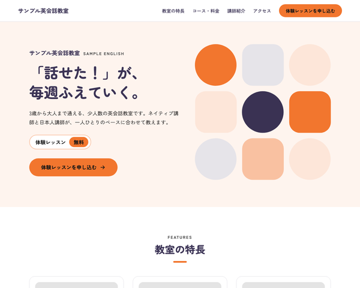

# BcLpSchoolTheme

baserCMS5用の、習い事の教室・スクールの紹介と、体験レッスンの申し込みのための1ページ LP（ランディングページ）テーマです。
教室の特長・コースと料金・講師紹介・時間割・生徒さんの声・お知らせ・アクセス・申し込みフォームまでを、
BurgerEditor のブロック操作と管理画面の設定だけで編集できます。

## 主な機能

- **1ページ LP**：トップの固定ページ1枚に、セクションを BurgerEditor のブロックで並べる構成
  - ヒーロー／教室の特長／コース・料金（コースのカード・入会金などの表）／講師紹介／時間割／生徒さん・保護者の声／お知らせ／体験レッスンの流れ／よくある質問／アクセス（地図）／体験レッスンのお申し込み（CTA）
  - セクションの追加・削除・並べ替えは、ブロック操作だけでできる
- **時間割の色分け**：時間割の表のマスにコース名を書くと、コースごとに色が付く（色の順番は、コース・料金のカードの順）
- **お知らせはブログ**：ブログ「お知らせ」の最新記事が、LP のお知らせに自動で並ぶ（ショートコード `[Lp.news]`）。記事の一覧・詳細ページも LP と同じデザイン
- **ページ内ナビの自動生成**：大見出しブロックの「ID設定」に英字（例 `teachers`）を入れると、ヘッダーのナビに載る。
  見出しの上には ID から作った英字のラベル（`TEACHERS`）が出る。`-and-` は ` & ` になる（`course-and-price` → `COURSE & PRICE`）
- **体験レッスンの申し込みフォーム**：入力 → 確認 → 完了の3画面。体験の希望日はカレンダーで選べる。項目は管理画面のメールフィールドで追加・並べ替えできる
- **テーマ設定の4色**で全体の配色が変わる（メイン／サブ／リンク／ホバー）。どの色にしても文字が読みやすいよう、文字の濃さと白黒を自動で調整する。ロゴもテーマ設定で変更できる
- **初期データ**：見本サイト一式（`default`、お知らせの記事3件を含む）と、最小構成（`empty`）
- レスポンシブ（PC／スマホ）、`prefers-reduced-motion` 対応

## 動作環境

- baserCMS5.4以上
- BurgerEditor（BcBurgerEditor）プラグインが有効であること
- ブログ（BcBlog）プラグインが有効であること（お知らせに使う。baserCMS の標準プラグイン）

## インストール

1. `plugins/BcLpSchoolTheme` に配置
2. 管理画面 > プラグイン管理 で BcBurgerEditor と BcBlog が有効になっていることを確認
3. 管理画面 > テーマ管理 で BcLpSchoolTheme を適用
4. 同じ画面で初期データ `default`（見本サイト）または `empty`（最小構成）を読み込む

> 初期データを読み込むと、ユーザー以外のデータ（固定ページ・メールフォーム・ブログ・サイト基本設定など）は初期化されます。
> 運用中のサイトでは読み込まないでください。

## 使い方

### 編集できる場所

| 内容 | 編集する場所 |
|---|---|
| 本文（全セクション） | 固定ページ「トップページ」の BurgerEditor |
| お知らせの記事 | ブログ「お知らせ」 |
| ロゴ・配色 | テーマ設定 |
| ヘッダーのナビ | 本文の大見出しブロックの「ID設定」（自動で作られる） |
| ヘッダーの「体験レッスンを申し込む」ボタンのリンク先 | 自動（公開中の最初のメールフォーム） |
| フォームの説明文・完了メッセージ・項目 | メールフォームの設定・メールフィールド |
| フッター（教室名・住所・電話・受付時間・SNS） | ウィジェットエリア「フッター」のテキストウィジェット |

### 本文ブロックの独自 class

ブロック設定の「独自class設定」に入れると、決まった見た目になります。
一覧と中身の書き方は `webroot/css/bge_style.css` の冒頭にあります。

| 独自 class | 使うブロック | 見た目 |
|---|---|---|
| `sc-blk--hero` | 画像右寄せ（テキスト回り込み無し） | ヒーロー（教室名・英字の教室名・キャッチ・紹介文・「体験レッスン 無料」・ボタン。写真が空なら丸と角丸の四角の図形） |
| `sc-blk--section` | 大見出し | セクション見出し（中央寄せ。英字ラベル＋下の短い線。ID 設定でナビと英字ラベル） |
| `sc-blk--nonav` | 大見出し（`sc-blk--section` と併用） | ナビに載せない |
| `sc-blk--lead` | 1カラムテキスト | 見出しの下のリード文（中央寄せ） |
| `sc-blk--features` | 画像3列＋テキスト | 教室の特長のカード（「01」は自動） |
| `sc-blk--courses` | 画像3列＋テキスト | コースのカード（画像は使わない。上の帯にコース名と対象、月謝の数字は大きく、内容はチェックの箇条書き） |
| `sc-blk--subhead` | 1カラムテキスト | セクションの中の小見出し（中央寄せ） |
| `sc-blk--table` | 2カラムテーブル | 角丸の枠の表（入会金・教材費など） |
| `sc-blk--note` | 1カラムテキスト | 表の下の小さな注記 |
| `sc-blk--teachers` | 画像3列＋テキスト | 講師のカード（役割のタグ・名前・ローマ字・担当・ひとこと） |
| `sc-blk--timetable` | 1カラムテキスト | 時間割（CKEditor の表。マスのコース名で色分け） |
| `sc-blk--voices` | 画像3列＋テキスト | 声のカード（画像は使わない。声と、学年・コースのタグ） |
| `sc-blk--news` | 1カラムテキスト | 段落に `[Lp.news]` と書くと、お知らせの最新3件が並ぶ |
| `sc-blk--steps` | 1カラムテキスト | 体験レッスンの流れ（番号付きリスト → 4枚のカード。「STEP 1」とアイコンは自動） |
| `sc-blk--faq` | 1カラムテキスト | よくある質問（質問ごとに開閉。最初の1問だけ開く） |
| `sc-blk--map` | GoogleMaps | 教室の地図（直後に `sc-blk--info` を置くと PC で2列） |
| `sc-blk--info` | 2カラムテーブル | 教室の情報の表 |
| `sc-blk--cta` | 1カラムテキスト | 体験レッスンの CTA（リード・ボタン・電話番号・受付時間） |
| `sc-blk--center` | 任意 | 中央寄せ |

ブロック設定の「背景色」は、テーマ色に置き換えています（ブルー＝メインのごく薄い色／グレー＝サブのごく薄い色／ピンク＝メインの薄い色）。

### 時間割

- 1カラムテキストのブロックに、CKEditor の表で作ります。1行目を曜日（見出しの行）、1列目を開始時刻（見出しの列）にします
- マスにコース名を書くと、色が付きます。色の順番は、コース・料金のカード（`sc-blk--courses`）の見出しの順です（1つめ＝メインの薄い色、2つめ＝サブの薄い色、3つめ＝白に線。4つめからは繰り返し）。カードにないコース名は、時間割に出てきた順に続きの色になります
- レッスンのない枠は「—」と書きます（読み上げでは「なし」と読まれます）

### お知らせ（ショートコード）

- 1カラムテキストのブロックの段落に `[Lp.news]` と書くと、公開画面ではブログ `news` の最新3件に置き換わります（編集エリアでは、点線の枠と説明が出ます）
- ブログ名と件数を変えるときは `[Lp.news ブログ名,件数]`（例 `[Lp.news news,5]`）と書きます
- 「埋め込みタグ」ブロックの中に書くと置き換わりません。1カラムテキストに書いてください

### 複数の場所に書かれている値を変えるとき

次の値は複数の場所に書かれているので、それぞれ直してください。

- **コース名**：コース・料金（`sc-blk--courses`）／時間割（`sc-blk--timetable`）／生徒さんの声のタグ／メールフィールド「希望のコース」の選択肢
- **料金**：コース・料金／入会金・教材費など（`sc-blk--table`）／よくある質問
- **電話番号・受付時間**：アクセス（`sc-blk--info`）／体験レッスンの CTA（`sc-blk--cta`）／フッター（ウィジェット）／メールフォームの送信完了メッセージ
- **レッスンの時間帯**：時間割／メールフィールド「希望の時間帯」の選択肢
- **教室名**：ヒーロー／フッター／メールフォームの差出人名・件名／テーマ設定のロゴの代替テキスト

### 配色の例

初期色はオレンジ（メイン）となす紺（サブ）です。テーマ設定の4色を変えると、次のような配色にできます。

| | 初期色（オレンジ） | 配色例（ミント） | 配色例（ピンク） |
|---|---|---|---|
| メイン | `#f2762e` | `#3fb59a` | `#ec6f9a` |
| サブ | `#3b3355` | `#244a52` | `#4a3550` |
| リンク | `#c95a1c` | `#1f8a72` | `#c2457a` |
| ホバー | `#9c4413` | `#166653` | `#97325c` |

## 設定

### 教室の地図（GoogleMaps ブロック）

- 管理画面 > システム設定 > サイト基本設定 で Google Maps API キーを登録してください
- キーの Google Cloud プロジェクトで、Maps JavaScript API・Geocoding API（編集画面の住所検索）・Maps Static API を有効にし、課金を設定してください
- Google のデモ用キーでは、地図の表示はできますが、編集画面の住所検索は使えません（地図をドラッグして位置を合わせてください）
- サイト基本設定の「GoogleMaps住所」は、このブロックには反映されません
- 公開するサイトで使うキーには、HTTP リファラーの制限を設定してください

### 体験レッスンの申し込みフォーム

- 「体験の希望日」はカレンダーで選べます（baserCMS に同梱の jQuery UI を、フォームの画面だけで読み込みます）
- 「個人情報の取り扱い」（チェックボックスの項目）は、入力画面では見出しの列をなくし、中央寄せの枠で表示します

## 制限事項

- コース名・電話番号などは各ブロックに直接書くため、変更時は複数の場所を直す必要があります（上記「複数の場所に書かれている値を変えるとき」）
- 初期データを読み込むと、お知らせの記事の投稿日は、読み込んだ時刻になります（baserCMS のブログの仕様）
- 教室の情報の表（`sc-blk--info`）のセルには HTML を書けないため、電話番号はリンクになりません。体験レッスンの CTA とフッターの電話番号はリンクです
- 時間割の色分けは JavaScript で付けます。マスに書いた文字がコース名と完全に一致したときに同じ色になります
- フォーム画面の見出しの上の英字「TRIAL LESSON」は、テンプレート（`templates/plugin/BcMail/Mail/default/*.php`）に書いています

## 同梱物・外部リソース

| 名前 | 用途 | ライセンス |
|---|---|---|
| [jQuery](https://jquery.com/) 3.7.1（`webroot/js/vendor/`） | BurgerEditor の公開側スクリプト（地図・YouTube・画像ポップアップ）と、日付のカレンダーの動作に必要 | MIT |
| jQuery UI 1.11.4 | 日付のカレンダー（baserCMS の bc-front に同梱のものを読み込む。このテーマには同梱していない） | MIT |
| [Google Fonts](https://fonts.google.com/)（Zen Kaku Gothic New・Zen Maru Gothic） | 本文・見出しのフォント（CDN から読み込み。同梱はしていない） | SIL Open Font License 1.1 |
| アイコン（`bge_style.css`・テンプレート内の SVG） | 矢印・チェック・引用符・手順・電話・開閉・完了のアイコン | [Lucide](https://lucide.dev/) のアイコンをもとにしている（ISC License） |

## ライセンス

MIT License
